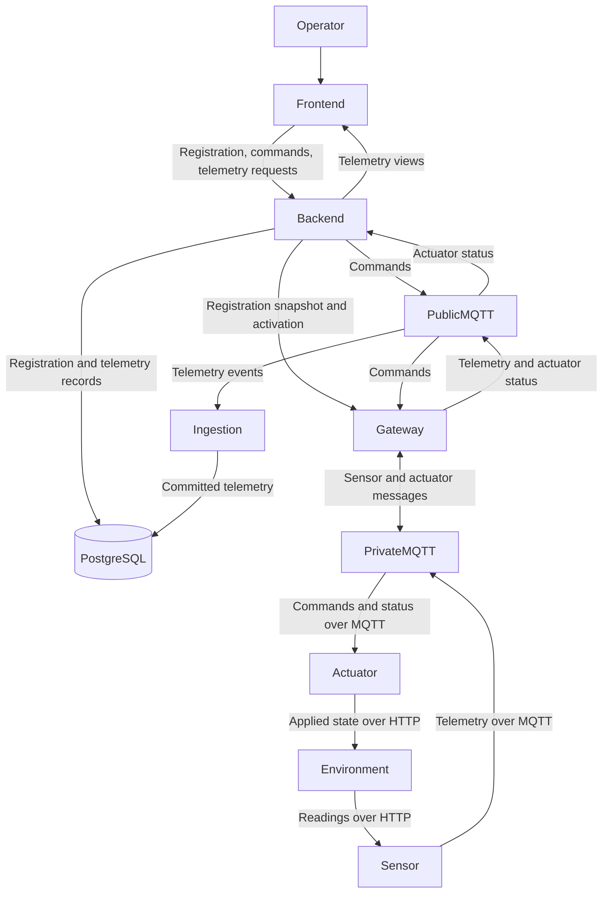

 
This repo is being used for IoT final project collaboration and final submission. team members: 
- Timila
- Earn
- Bmk  
- Raymond
- Juji

# Component Flow



# Git & GitHub Basic Commands

This section covers the basic Git commands and workflow used by our team. Everyone should follow the same workflow to avoid overwriting each other's work.

## 1. Initial Setup

Install Git and configure your identity (only required once per computer).

```
git config --global user.name "Your Name"
git config --global user.email "your@email.com"
```

Clone the project repository to your computer:

```
git clone https://github.com/USERNAME/REPOSITORY.git
```

Enter the project folder:

```
cd REPOSITORY
```

## 2. Basic Git Commands

|Command|Purpose|
|---|---|
|`git status`|Check which files have changed.|
|`git pull`|Download the latest changes from GitHub.|
|`git add .`|Stage all changed files for a commit.|
|`git commit -m "message"`|Save changes as a commit locally.|
|`git push`|Upload commits to GitHub.|
|`git branch`|View existing local branches.|
|`git switch branch-name`|Switch to another branch.|
|`git switch -c branch-name`|Create and switch to a new branch.|
|`git log --oneline`|View recent commits.|

## 3. Our Team Workflow

Every member should follow these steps when working on a new task.

### Step 1: Get the latest changes

Before starting work, update your local project:

```
git switch main
git pull origin main
```

### Step 2: Create your own branch

Create a separate branch for your task.

```
git switch -c feature/your-task
```

Examples:

- `feature/frontend`
    
- `feature/backend-api`
    
- `feature/sensor-client`
    
- `feature/database`
    
- `feature/mqtt-communication`
    

### Step 3: Work on your assigned task

Make changes to the project files using your preferred editor.

Check your changes:

```
git status
```

### Step 4: Save your changes

Stage and commit your work:

```
git add .    #the period basically means add everything
git commit -m "Add sensor data collection"   # -m tag required to add the commit message
```

Use short, descriptive commit messages that explain what you changed.

### Step 5: Upload your branch to GitHub

```
git push -u origin feature/your-task
```

For subsequent uploads from the same branch, simply use:

```
git push
```

### Step 6: Create a Pull Request (PR)

1. Open our repository on GitHub.
    
2. Select **Compare & pull request**.
    
3. Set the base branch to `main`.
    
4. Set the compare branch to your feature branch.
    
5. Describe what you implemented.
    
6. Ask another team member to review your changes.
    
7. Merge the PR after approval.
    

### Step 7: Update your local project

After your PR has been merged:

```
git switch main
git pull origin main
```

Your local `main` branch will now contain the latest project version.

---

## 4. Important Rules

1. **Never work directly on** `**main**`**.** Always create your own branch.
    
2. **Pull before starting new work.** Avoid working with outdated code.
    
3. **Commit regularly.** Do not wait until the entire feature is finished.
    
4. **Use descriptive commit messages.** Explain what changed.
    
5. **Review before merging.** Check other members' changes through Pull Requests.
    
6. **Do not commit unnecessary files.** Avoid uploading temporary files, IDE settings, virtual environments or sensitive information such as API keys.
    
7. **Communicate before modifying shared files.** Especially configuration files, database schemas and core application files.
    

## 5. Handling Merge Conflicts

A merge conflict occurs when Git cannot automatically combine changes, usually because multiple people modified the same part of a file.

If this happens:

1. Run `git status` to identify conflicting files.
    
2. Open the affected files in your editor.
    
3. Look for conflict markers (`<<<<<<<`, `=======`, `>>>>>>>`).
    
4. Decide which changes should be kept and combine them.
    
5. Remove the conflict markers.
    
6. Stage and commit the resolved files.
    

```
git add .
git commit -m "Resolve merge conflicts"
```

If you are unsure which changes to keep, ask the relevant team members before resolving the conflict.

## 6. Quick Reference

Typical workflow when implementing a feature:

```
# Update local project
git switch main
git pull origin main

# Create a new branch
git switch -c feature/my-task

# Work on your files...

# Save changes
git add .
git commit -m "Describe your changes"

# Upload to GitHub
git push -u origin feature/my-task

# Create a Pull Request on GitHub
# Wait for review and merge

# Update local main after merging
git switch main
git pull origin main
```

# IoT System Architecture

## Overview

The system connects sensors and actuators to a frontend through MQTT, HTTP and a backend API. PostgreSQL stores registration and telemetry data.

## Components

- **Operator:** Uses the frontend to interact with the system.
    
- **Frontend:** Sends registration requests, actuator commands and telemetry requests.
    
- **Backend API:** Manages registration, commands, telemetry requests and database communication.
    
- **Public MQTT Broker:** Handles communication between the backend, gateway and ingestion workers.
    
- **Gateway:** Connects the public and private MQTT brokers.
    
- **Private MQTT Broker:** Handles communication with sensor and actuator clients.
    
- **Sensor Clients:** Collect environmental readings through HTTP and send telemetry through MQTT.
    
- **Actuator Clients:** Receive commands through MQTT and apply changes through HTTP.
    
- **Environment Service:** Provides sensor readings and receives actuator updates.
    
- **Ingestion Workers:** Process incoming telemetry and store it in PostgreSQL.
    
- **PostgreSQL:** Stores registration and telemetry records.
